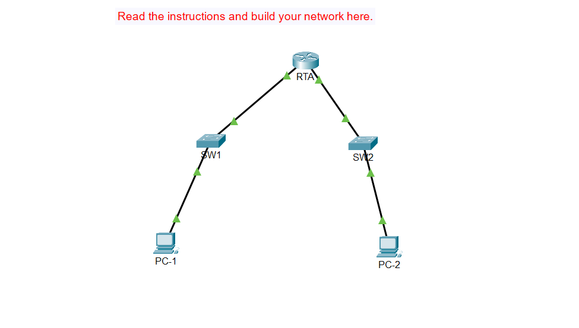

# Lab 01: SRWE Basic Router & Switch Configuration

## Objective
Configure initial device hostnames, encrypted privileged EXEC passwords, console and VTY remote access lines, MOTD banners, and Layer 2 SVI management interfaces with default gateways.

## Network Topology


## Addressing & Management Table
| Device | Interface | IP Address | Subnet Mask | Default Gateway |
| :--- | :--- | :--- | :--- | :--- |
| R1 | [e.g., G0/0] | [Router IP] | [Subnet Mask] | N/A |
| SW1 | VLAN 1 | [SW1 IP] | [Subnet Mask] | [Default Gateway] |
| SW2 | VLAN 1 | [SW2 IP] | [Subnet Mask] | [Default Gateway] |

## Key Configurations Implemented

### Router Security & VTY Access
\```text
enable secret Ciscoenpa55
line console 0
 password Ciscolinepa55
 login
line vty 0 15
 password Ciscolinepa55
 login
 transport input all
banner motd #Authorized Access Only!#
\```

### Switch Management SVI & Default Gateway (SW1 & SW2)
\```text
interface vlan 1
 ip address [Switch_IP] [Subnet_Mask]
 no shutdown
ip default-gateway [Default_Gateway_IP]
\```

## Verification
* Confirmed active interfaces (`up/up`) using `show ip interface brief`.
* Verified local and remote network reachability via ICMP `ping` and remote VTY login access.
* Saved all running configurations to NVRAM (`copy running-config startup-config`).
